# 🏢 Windows Server 2022 Active Directory Lab




> **Summary:** A hands-on Active Directory home lab built in Oracle VirtualBox. It starts with a Windows Server 2022 domain controller (AD DS, DNS, AD CS) and grows phase by phase into a managed, monitored, and eventually attackable Windows environment.


<details>
<summary><b>Table of Contents</b></summary>

- [🧭 Lab Architecture](#-lab-architecture)
- [📚 Phases](#-phases)
- [📁 Repository Structure](#-repository-structure)
- [🚀 Roadmap](#-roadmap)

</details>

</details>

---

## 🧭 Lab Architecture

| Host | Role | IP Address | Details |
|---|---|---|---|
| `DC01` | Domain Controller | `10.0.2.15` | Windows Server 2022, forest `LAB.local`, AD DS, DNS, Global Catalog, AD CS Enterprise Root CA |
| `WS01` | Domain Client | `10.0.2.16` | Windows 11 Enterprise Evaluation, joined to `LAB.local` |

**Hypervisor:** Oracle VirtualBox

---

## 📚 Phases

| Phase | Project | Status | Skills Demonstrated |
|---|---|---|---|
| 1 | [Domain Controller Build](docs/01-domain-controller-build.md) | Completed | AD DS, DNS, Global Catalog, AD CS, verification (dcdiag, certutil) |
| 2 | [Windows 11 Domain Join](docs/02-windows11-domain-join.md) | Completed | Static IP, DNS design, client join, ADUC verification |
| 3 | Organizational Units and Users | Completed | AD structure, account management |


---

## 🗂 Repository Structure

```
windows-server-ad-lab/
├── README.md
├── docs/
    ├── 01-domain-controller-build.md
    └── 02-windows11-domain-join.md

```

---

## 🚀 Roadmap

- [x] Build and promote the domain controller
- [x] Deploy AD CS as an Enterprise Root CA
- [x] Join a Windows 11 client to the domain
- [x] Create an OU structure and domain users

---
