# 💻🔗 Joining a Windows 11 Client to an Active Directory Domain

[![Windows Server 2022][b-server]](01-domain-controller-build.md)
[![Windows 11][b-client]](#-phase-2-prepare-the-windows-11-client)
[![Active Directory][b-ad]](#-network-design)
[![DNS][b-dns]](#-network-design)

[![VirtualBox][b-vbox]](#-lab-environment)
[![Domain Join][b-join]](#-phase-4-verify-on-the-domain-controller)
[![Progress][b-progress]](../README.md#-phases)
[![Status][b-status]](#-key-takeaways)

[b-server]: https://img.shields.io/badge/Windows_Server-2022-0078D4?style=for-the-badge&labelColor=6E7681&logo=data:image/svg+xml;base64,PHN2ZyB4bWxucz0iaHR0cDovL3d3dy53My5vcmcvMjAwMC9zdmciIHZpZXdCb3g9IjAgMCAyNCAyNCI%2BPHBhdGggZmlsbD0id2hpdGUiIGQ9Ik0wIDMuNDQ5IDkuNzUgMi4xdjkuNDUxSDBtMTAuOTQ5LTkuNjAyTDI0IDB2MTEuNEgxMC45NDlNMCAxMi42aDkuNzV2OS40NTFMMCAyMC42OTlNMTAuOTQ5IDEyLjZIMjRWMjRsLTEyLjktMS44MDEiLz48L3N2Zz4%3D
[b-client]: https://img.shields.io/badge/Windows_11-Enterprise-0078D4?style=for-the-badge&labelColor=6E7681&logo=data:image/svg+xml;base64,PHN2ZyB4bWxucz0iaHR0cDovL3d3dy53My5vcmcvMjAwMC9zdmciIHZpZXdCb3g9IjAgMCAyNCAyNCI%2BPHBhdGggZmlsbD0id2hpdGUiIGQ9Ik0wIDMuNDQ5IDkuNzUgMi4xdjkuNDUxSDBtMTAuOTQ5LTkuNjAyTDI0IDB2MTEuNEgxMC45NDlNMCAxMi42aDkuNzV2OS40NTFMMCAyMC42OTlNMTAuOTQ5IDEyLjZIMjRWMjRsLTEyLjktMS44MDEiLz48L3N2Zz4%3D
[b-ad]: https://img.shields.io/badge/Active_Directory-LAB.local-005A9E?style=for-the-badge&labelColor=6E7681
[b-dns]: https://img.shields.io/badge/DNS-Configured-F57C00?style=for-the-badge&labelColor=6E7681
[b-vbox]: https://img.shields.io/badge/VirtualBox-Lab_Host-2F61B4?style=for-the-badge&labelColor=6E7681&logo=virtualbox&logoColor=white
[b-join]: https://img.shields.io/badge/Domain_Join-Verified-5391FE?style=for-the-badge&labelColor=6E7681
[b-progress]: https://img.shields.io/badge/Phase-2_of_5-00A88E?style=for-the-badge&labelColor=6E7681
[b-status]: https://img.shields.io/badge/Status-Completed-2EA043?style=for-the-badge&labelColor=6E7681

> **Summary:** This project extends my Active Directory lab by onboarding a Windows 11 workstation (`WS01`) to the `LAB.local` domain managed by my Windows Server 2022 domain controller (`DC01`). It covers static IP configuration, DNS design, client renaming, the domain join process, and verification from the server side.

---

📌 <b>Table of Contents</b> (Click to expand)

- [🎯 Overview](#-overview)
- [🧪 Lab Environment](#-lab-environment)
- [🌐 Network Design](#-network-design)
- [🔧 Phase 1: Configure the Domain Controller Network (Windows Server 2022)](#-phase-1-configure-the-domain-controller-network-windows-server-2022)
- [💻 Phase 2: Prepare the Windows 11 Client](#-phase-2-prepare-the-windows-11-client)
- [🔗 Phase 3: Join the Domain](#-phase-3-join-the-domain)
- [✅ Phase 4: Verify on the Domain Controller](#-phase-4-verify-on-the-domain-controller)
- [🔒 Security Considerations](#-security-considerations)
- [💡 Key Takeaways](#-key-takeaways)
- [🚀 Next Steps](#-next-steps)

---

## 🎯 Overview

A domain controller is only useful once machines join it. In this phase of the lab I attached a Windows 11 client to the `LAB.local` domain so that it can be centrally authenticated, managed, and (in later phases) governed by Group Policy.

**Objectives**

- Assign static IP addressing to the domain controller and the client
- Point the client at the domain controller for DNS so it can locate the domain
- Rename the client with a clear, consistent hostname
- Join the client to `LAB.local`
- Confirm the computer object was created in Active Directory

---

## 🧪 Lab Environment

| Component | Details |
|---|---|
| Hypervisor | Oracle VirtualBox |
| Domain Controller | Windows Server 2022 Standard Evaluation (`DC01`) |
| Domain | `LAB.local` |
| Server Roles | AD DS, DNS, AD CS (Enterprise Root CA) |
| Client | Windows 11 Enterprise Evaluation (renamed to `WS01`) |

---

## 🌐 Network Design

| Host | Role | IP Address | Subnet Mask | Default Gateway | Preferred DNS |
|---|---|---|---|---|---|
| `DC01` | Domain Controller | `10.0.2.15` | `255.255.255.0` | `10.0.2.2` | `127.0.0.1` (itself) |
| `WS01` | Domain Client | `10.0.2.16` | `255.255.255.0` | `10.0.2.2` | `10.0.2.15` (`DC01`) |

> **Why this matters:** Active Directory depends on DNS. Domain clients locate domain controllers through SRV records stored in the domain's DNS zone. If the client's DNS server is not the domain controller (or something that forwards to it), the join fails with a "domain could not be contacted" error. Setting `WS01`'s DNS to `10.0.2.15` is the most important configuration step in this project.

---

## 🔧 Phase 1: Configure the Domain Controller Network (Windows Server 2022)

A domain controller should never rely on a changing DHCP address, so `DC01` is given a static IP. Because it hosts DNS itself, it uses the loopback address as its preferred DNS server.

**Steps**

1. Click the network icon in the system tray and select **Network & Internet settings**.

   

2. Under **Advanced network settings**, select **Change adapter options**.

   

3. Right-click the **Ethernet** adapter and choose **Properties**.

   

4. Select **Internet Protocol Version 4 (TCP/IPv4)** and click **Properties**.

    

5. Choose **Use the following IP address** and enter the values below, then click **OK**.

   | Setting | Value |
   |---|---|
   | IP address | `10.0.2.15` |
   | Subnet mask | `255.255.255.0` |
   | Default gateway | `10.0.2.2` |
   | Preferred DNS server | `127.0.0.1` |

   

---

## 💻 Phase 2: Prepare the Windows 11 Client

### 🏷 Rename the computer

The default name (`DESKTOP-40MST3`) is replaced with `WS01`. Consistent naming makes machines easy to identify in Active Directory, logs, and Group Policy scoping.

1. Search for **View your PC name** and open it.

   

2. Click **Rename this PC**, enter `WS01`, and click **Next**. (A restart is requested, which can be combined with the domain join restart later.)

   

### 🌐 Configure static IP and DNS

3. Search for **View network connections** and open it.

   

4. Right-click **Ethernet** and select **Properties**.

   

5. Select **Internet Protocol Version 4 (TCP/IPv4)** and click **Properties**.

   

6. Enter the static configuration below and click **OK**. The **Preferred DNS server** points to the domain controller.

   | Setting | Value |
   |---|---|
   | IP address | `10.0.2.16` |
   | Subnet mask | `255.255.255.0` |
   | Default gateway | `10.0.2.2` |
   | Preferred DNS server | `10.0.2.15` |

   

---

## 🔗 Phase 3: Join the Domain

1. Search for **Access work or school** and open it.

   

2. Click **Connect**.

   

3. In the **Set up a work or school account** window, select **Join this device to a local Active Directory domain** (not Microsoft Entra ID, since this is an on-premises domain).

   

4. Enter the domain name `LAB.local` and click **Next**.

   

5. When prompted, authenticate with a domain account that has permission to join computers to the domain.

   

6. In the **Add an account** step, specify the account that will use this PC and its account type (Standard User or Administrator), then click **Next**.

   

7. Click **Restart now** to finish. After the reboot, the PC is a member of `LAB.local`.

   

---

## ✅ Phase 4: Verify on the Domain Controller

A successful join should be confirmed from the server side, not just assumed from the client.

1. On `DC01`, open **Server Manager**, then go to **Tools** > **Active Directory Users and Computers**.

    

2. Expand `LAB.local` and select the **Computers** container. The `WS01` computer object is listed, confirming the join.

   

**Result:** `WS01` appears in the `Computers` container of `LAB.local`. The client now authenticates against `DC01` and is ready for centralized management.

---

## 🔒 Security Considerations

- **Static addressing for infrastructure:** The domain controller keeps a fixed IP so DNS records and client configuration stay stable.
- **Least privilege for joins:** I used the built-in domain administrator for speed in an isolated lab. In production, join permissions should be delegated to a dedicated service or helpdesk account instead of using Domain Admin credentials.
- **Default container:** New computer objects land in the default `Computers` container, where most Group Policy cannot be linked. They should be moved into a dedicated Organizational Unit (OU).
- **Evaluation software and isolation:** Both systems are evaluation builds running in an isolated virtual network, appropriate for lab use only.

---

## 💡 Key Takeaways

- Active Directory domain joins are fundamentally a **DNS problem**: the client must resolve the domain through the domain controller.
- Static IPs and clear hostnames are small steps that make a lab (and a real environment) easier to manage and troubleshoot.
- Verifying the computer object in Active Directory Users and Computers confirms the trust relationship was established.
- Joining a device to a local AD domain differs from Microsoft Entra ID join, and picking the right option matters.

---

*Part of my [Windows Server 2022 Active Directory lab](https://github.com/leoul07/windows-server-ad-lab/tree/main). See the main project README for the domain controller, AD DS, and AD CS build.*
