# 👥🔑 Creating Domain Users in Active Directory





<div align="center">

[![Windows Server 2022][b-server]](01-domain-controller-build.md)
[![Active Directory][b-ad]](../README.md#-lab-architecture)
[![ADUC][b-tool]](#-phase-1-open-active-directory-users-and-computers)
[![User Accounts][b-user]](#-phase-4-verify-the-new-account)

[![VirtualBox][b-vbox]](../README.md#-lab-architecture)
[![Credential Hygiene][b-sec]](#-security-considerations)
[![Progress][b-progress]](../README.md#-phases)
[![Status][b-status]](#-key-takeaways)

</div>

[b-server]: https://img.shields.io/badge/Windows_Server-2022-0078D4?style=for-the-badge&labelColor=6E7681&logo=data:image/svg+xml;base64,PHN2ZyB4bWxucz0iaHR0cDovL3d3dy53My5vcmcvMjAwMC9zdmciIHZpZXdCb3g9IjAgMCAyNCAyNCI%2BPHBhdGggZmlsbD0id2hpdGUiIGQ9Ik0wIDMuNDQ5IDkuNzUgMi4xdjkuNDUxSDBtMTAuOTQ5LTkuNjAyTDI0IDB2MTEuNEgxMC45NDlNMCAxMi42aDkuNzV2OS40NTFMMCAyMC42OTlNMTAuOTQ5IDEyLjZIMjRWMjRsLTEyLjktMS44MDEiLz48L3N2Zz4%3D
[b-ad]: https://img.shields.io/badge/Active_Directory-LAB.local-005A9E?style=for-the-badge&labelColor=6E7681
[b-tool]: https://img.shields.io/badge/Tool-ADUC-0078D4?style=for-the-badge&labelColor=6E7681
[b-user]: https://img.shields.io/badge/User_Accounts-Created-8E24AA?style=for-the-badge&labelColor=6E7681
[b-vbox]: https://img.shields.io/badge/VirtualBox-Lab_Host-2F61B4?style=for-the-badge&labelColor=6E7681&logo=virtualbox&logoColor=white
[b-sec]: https://img.shields.io/badge/Credential_Hygiene-Forced_Reset-F57C00?style=for-the-badge&labelColor=6E7681
[b-progress]: https://img.shields.io/badge/Phase-3_of_5-00A88E?style=for-the-badge&labelColor=6E7681
[b-status]: https://img.shields.io/badge/Status-Completed-2EA043?style=for-the-badge&labelColor=6E7681

> **Summary:** This project adds identities to my `LAB.local` Active Directory domain. Using Active Directory Users and Computers (ADUC) on the domain controller, I created domain user accounts with three different methods (two in the ADUC console and one with PowerShell), configured the logon name and an initial password that must be changed at first logon, and confirmed the account in the directory.

<details>
 <summary>📌 <b>Table of Contents</b> (Click to expand)</summary>

- [🎯 Overview](#-overview)
- [🧪 Lab Environment](#-lab-environment)
- [🧾 Account Design](#-account-design)
- [🔧 Phase 1: Open Active Directory Users and Computers](#-phase-1-open-active-directory-users-and-computers)
- [👤 Phase 2: Choose a Method to Create the User](#-phase-2-choose-a-method-to-create-the-user)
- [📝 Phase 3: Complete the New User Wizard](#-phase-3-complete-the-new-user-wizard)
- [✅ Phase 4: Verify the New Account](#-phase-4-verify-the-new-account)
- [🔒 Security Considerations](#-security-considerations)
- [💡 Key Takeaways](#-key-takeaways)
- [🚀 Next Steps](#-next-steps)

</details>

---

## 🎯 Overview

A domain with no users is just infrastructure. Identity is what Active Directory exists to manage: who a person is, how they sign in, and what they can reach. In this phase of the lab I created a user account in `LAB.local` from the domain controller, so that a person can sign in to domain-joined machines such as `WS01`.

**Objectives**

- Open Active Directory Users and Computers from Server Manager
- Create a domain user using three methods: the ADUC toolbar, the ADUC right-click menu, and PowerShell
- Set a consistent logon name and an initial password
- Force the user to choose their own password at first logon
- Confirm the new account appears in the directory

---

## 🧪 Lab Environment

| Component | Details |
|---|---|
| Hypervisor | Oracle VirtualBox |
| Domain Controller | Windows Server 2022 Standard Evaluation (`DC01`) |
| Domain | `LAB.local` |
| Management tool | Active Directory Users and Computers (ADUC) |
| Target container | `LAB.local/Users` |

---

## 🧾 Account Design

Before creating the account I decided on its attributes, so the result is consistent and easy to repeat.

| Attribute | Value | Notes |
|---|---|---|
| First name | `Jared` | |
| Last name | `Dunn` | |
| Full name | `Jared Dunn` | Display name shown in ADUC |
| User logon name | `jdunn@LAB.local` | User principal name (UPN) |
| Pre-Windows 2000 logon | `LAB\jdunn` | Legacy `DOMAIN\user` format |
| Container | `LAB.local/Users` | Default container for user objects |
| Password option | Must change at next logon | Admin does not know the final password |

> **Naming convention:** Logon names follow a first initial plus last name pattern (`jdunn`). A predictable convention makes accounts easy to find, audit, and script later.

---

## 🔧 Phase 1: Open Active Directory Users and Computers

ADUC is the main console for managing users, groups, and computers in the domain.

1. On `DC01`, open **Server Manager**.
2. Click **Tools** in the top-right menu and select **Active Directory Users and Computers**.

   


3. Expand `LAB.local` and select the **Users** container.

---

## 👤 Phase 2: Choose a Method to Create the User

ADUC offers more than one way to start the same wizard, and PowerShell can create the same account from the command line. I used all three.

### 🔹 Method 1: Toolbar button

With the **Users** container selected, click the **Create a new user in the current container** icon in the ADUC toolbar.


### 🔸 Method 2: Right-click menu

Right-click an empty area in the **Users** container, then choose **New** > **User**.


> Both methods open the same **New Object - User** wizard, so the choice is just a matter of preference. The toolbar is quicker for repeated use, while the right-click menu also lets you create other object types such as groups and computers.

### 🔷 Method 3: PowerShell

For repeatable account creation, I also created a user from an elevated PowerShell session on `DC01` using the `New-ADUser` cmdlet from the Active Directory module (installed with the AD DS role and its management tools).

```powershell
New-ADUser -Name "Jared Dunn" -GivenName "Jared" -Surname "Dunn" `
  -SamAccountName "jdunn" -UserPrincipalName "jdunn@LAB.local" `
  -Path "CN=Users,DC=LAB,DC=local" `
  -AccountPassword (Read-Host -AsSecureString "Initial password") `
  -ChangePasswordAtLogon $true -Enabled $true
```

| Parameter | Purpose |
|---|---|
| `-Name`, `-GivenName`, `-Surname` | Full, first, and last name (same fields as the wizard) |
| `-SamAccountName` | Pre-Windows 2000 logon name (`LAB\jdunn`) |
| `-UserPrincipalName` | Modern logon name (`jdunn@LAB.local`) |
| `-Path` | Container to create the account in (`CN=Users,DC=LAB,DC=local`) |
| `-AccountPassword (Read-Host -AsSecureString ...)` | Prompts for the password instead of storing it in the script |
| `-ChangePasswordAtLogon $true` | Same as the "must change password at next logon" checkbox |
| `-Enabled $true` | Account is active immediately |


> The command produces the same result as the wizard, but it can be saved, reviewed, and reused, which is the foundation for bulk account creation later.

---

## 📝 Phase 3: Complete the New User Wizard

### Step 1: Name and logon details

Enter the user's name and logon name, then click **Next**. The full name is built automatically from the first and last name, and the pre-Windows 2000 name is filled in from the logon name.

| Field | Value |
|---|---|
| First name | `Jared` |
| Last name | `Dunn` |
| Full name | `Jared Dunn` |
| User logon name | `jdunn` with suffix `@LAB.local` |
| User logon name (pre-Windows 2000) | `LAB\jdunn` |


### Step 2: Password and account options

Enter and confirm an initial password. The options I selected:

| Option | Setting |
|---|---|
| User must change password at next logon | Checked |
| User cannot change password | Unchecked |
| Password never expires | Unchecked |
| Account is disabled | Unchecked |


### Step 3: Review and finish

The summary page shows the full name, the logon name (`jdunn@LAB.local`), and that the user must change the password at next logon. Click **Finish** to create the account.


---

## ✅ Phase 4: Verify the New Account

After finishing the wizard, the new account appears in the **Users** container in ADUC, listed alongside the built-in `Administrator` and `Guest` accounts. The object type is **User**, confirming the directory accepted the account.

The earlier screenshots of the toolbar and right-click methods show the `Users` container populated with the created accounts, including `Jared Dunn`.

**Result:** A new domain user exists in `LAB.local/Users`, ready to sign in with the initial password and prompted to set a new one at first logon.

---

## 🔒 Security Considerations

- **Forced password change:** Requiring a change at next logon means the administrator who typed the initial password does not keep knowing it. The user becomes the only holder of their credential.
- **Strong initial password:** The password still has to satisfy the domain's password policy. The initial password should be unique, never reused, and delivered through a secure channel.
- **No passwords in scripts:** The PowerShell method prompts for the password with `Read-Host -AsSecureString`, so the credential is never written into the command or the script file.
- **No unnecessary options:** "Password never expires" and "User cannot change password" were left off, so the account follows normal password-aging behavior. "Account is disabled" was also left off, so the account is usable immediately. In a real environment, new accounts are sometimes created disabled and enabled only once a request is approved.
- **Least privilege by default:** The new user is a regular domain user and was not added to any privileged group such as Domain Admins.
- **Default container:** This account was created in the built-in `Users` container. Group Policy generally cannot be linked to that container, so accounts should later be moved into dedicated Organizational Units (OUs).

---

## 💡 Key Takeaways

- ADUC offers several ways to start the same task, and knowing the quick options saves time in daily administration.
- A consistent naming convention (`jdunn@LAB.local` and `LAB\jdunn`) keeps a directory tidy and auditable.
- The "must change password at next logon" option is a simple but meaningful credential-hygiene control.
- Account creation involves security decisions (password handling, account state, group membership), not just filling in a form.
- The same account can be created in the GUI or with `New-ADUser`, and scripting it is the first step toward consistent, repeatable administration.

---


*Part of my [Windows Server 2022 Active Directory Lab](../README.md).*
