# 📂👥 Organizational Units and Security Groups in Active Directory



<div align="center">

[![Windows Server 2022][b-server]](01-domain-controller-build.md)
[![Active Directory][b-ad]](../README.md#-lab-architecture)
[![ADUC][b-tool]](#-phase-1-open-active-directory-users-and-computers)
[![Organizational Units][b-ou]](#-directory-design)

[![Security Groups][b-group]](#-phase-5-create-a-security-group)
[![VirtualBox][b-vbox]](../README.md#-lab-architecture)
[![Progress][b-progress]](../README.md#-phases)
[![Status][b-status]](#-key-takeaways)

</div>

[b-server]: https://img.shields.io/badge/Windows_Server-2022-0078D4?style=for-the-badge&labelColor=6E7681&logo=data:image/svg+xml;base64,PHN2ZyB4bWxucz0iaHR0cDovL3d3dy53My5vcmcvMjAwMC9zdmciIHZpZXdCb3g9IjAgMCAyNCAyNCI%2BPHBhdGggZmlsbD0id2hpdGUiIGQ9Ik0wIDMuNDQ5IDkuNzUgMi4xdjkuNDUxSDBtMTAuOTQ5LTkuNjAyTDI0IDB2MTEuNEgxMC45NDlNMCAxMi42aDkuNzV2OS40NTFMMCAyMC42OTlNMTAuOTQ5IDEyLjZIMjRWMjRsLTEyLjktMS44MDEiLz48L3N2Zz4%3D
[b-ad]: https://img.shields.io/badge/Active_Directory-LAB.local-005A9E?style=for-the-badge&labelColor=6E7681
[b-tool]: https://img.shields.io/badge/Tool-ADUC-0078D4?style=for-the-badge&labelColor=6E7681
[b-ou]: https://img.shields.io/badge/Organizational_Units-3_%2B_1_Nested-8E24AA?style=for-the-badge&labelColor=6E7681
[b-group]: https://img.shields.io/badge/Security_Group-Global-F57C00?style=for-the-badge&labelColor=6E7681
[b-vbox]: https://img.shields.io/badge/VirtualBox-Lab_Host-2F61B4?style=for-the-badge&labelColor=6E7681&logo=virtualbox&logoColor=white
[b-progress]: https://img.shields.io/badge/Phase-4_of_6-00A88E?style=for-the-badge&labelColor=6E7681
[b-status]: https://img.shields.io/badge/Status-Completed-2EA043?style=for-the-badge&labelColor=6E7681

> **Summary:** This project gives the `LAB.local` directory a real structure. Using Active Directory Users and Computers (ADUC), I created Organizational Units (OUs) for Engineering, Management, and IT, nested an `Administrators` OU inside IT, organized user accounts into the OUs, and created a global security group (`EngineeringShare`) whose members come from more than one OU.

<details>
<summary> 📌 <b>Table of Contents</b> (Click to expand) </summary>

- [🎯 Overview](#-overview)
- [🧪 Lab Environment](#-lab-environment)
- [🧾 Directory Design](#-directory-design)
- [🔧 Phase 1: Open Active Directory Users and Computers](#-phase-1-open-active-directory-users-and-computers)
- [📂 Phase 2: Create the Organizational Units](#-phase-2-create-the-organizational-units)
- [🧱 Phase 3: Create a Nested OU](#-phase-3-create-a-nested-ou)
- [🚚 Phase 4: Organize Users into OUs](#-phase-4-organize-users-into-ous)
- [🔐 Phase 5: Create a Security Group](#-phase-5-create-a-security-group)
- [🧩 Phase 6: Add Members to the Group](#-phase-6-add-members-to-the-group)
- [✅ Phase 7: Verify Group Membership](#-phase-7-verify-group-membership)
- [🔒 Security Considerations](#-security-considerations)
- [💡 Key Takeaways](#-key-takeaways)
- [🚀 Next Steps](#-next-steps)

</details>

---

## 🎯 Overview

Creating users is only the start. A directory with every account in one default container does not scale: there is no way to delegate administration, target Group Policy, or grant access cleanly. Active Directory solves this with two complementary tools:

- **Organizational Units (OUs)** organize objects into a hierarchy that mirrors the business, and they are the unit that Group Policy and delegated administration attach to.
- **Security groups** collect accounts so that access can be granted to a group once, instead of to each person individually.

**Objectives**

- Create OUs that reflect departments (Engineering, Management, IT)
- Create a nested OU for administrative accounts inside IT
- Place existing user accounts into the correct OUs
- Create a security group and add members from different OUs
- Verify the membership in the group properties

---

## 🧪 Lab Environment

| Component | Details |
|---|---|
| Hypervisor | Oracle VirtualBox |
| Domain Controller | Windows Server 2022 Standard Evaluation (`DC01`) |
| Domain | `LAB.local` |
| Management tool | Active Directory Users and Computers (ADUC) |
| Starting point | Domain users created in the default `Users` container (see [Phase 3](03-creating-domain-users.md)) |

---

## 🧾 Directory Design

I planned the structure before building it, so each object has a clear purpose.

```
LAB.local
├── Engineering          (OU)  users + the EngineeringShare group
├── Management           (OU)  users
├── IT                   (OU)
│   └── Administrators   (nested OU)
├── Users                (default container)
└── ...                  (built-in containers)
```

| Object | Type | Purpose |
|---|---|---|
| `Engineering` | OU | Engineering department accounts and groups |
| `Management` | OU | Management accounts |
| `IT` | OU | IT department objects |
| `IT\Administrators` | Nested OU | Separate location for administrative accounts |
| `EngineeringShare` | Global security group | Grants access to Engineering resources, created in the `Engineering` OU |

---

## 🔧 Phase 1: Open Active Directory Users and Computers

1. On `DC01`, open **Server Manager**.
2. Click **Tools** and select **Active Directory Users and Computers**.

   


---

## 📂 Phase 2: Create the Organizational Units

OUs are created at the domain level so they sit alongside the built-in containers.

1. In the ADUC tree, right-click the domain `LAB.local`, then choose **New** > **Organizational Unit**.

   


2. In **New Object - Organizational Unit**, enter the name `Engineering`. Leave **Protect container from accidental deletion** checked and click **OK**.

   


3. Repeat the process to create `Management`.

   


4. Repeat once more to create `IT`.

   


After the three OUs are created, they appear in the tree under `LAB.local`, next to the default `Users` container.

---

## 🧱 Phase 3: Create a Nested OU

OUs can contain other OUs. I created an `Administrators` OU inside `IT` so administrative accounts have their own location that can later receive stricter policy.

1. Right-click the **IT** OU and choose **New** > **Organizational Unit**.
2. Enter the name `Administrators`. The dialog shows it is being created in `LAB.local/IT`. Keep **Protect container from accidental deletion** checked and click **OK**.


   

---

## 🚚 Phase 4: Organize Users into OUs

With the structure in place, the existing user accounts were moved from the default `Users` container into the OU that matches their department. Selecting each OU in ADUC shows what it now holds.

| OU | Accounts shown in ADUC |
|---|---|
| `Engineering` | Nelson Bighetti, Richard Hendricks |
| `Management` | Jared Dunn and one additional user |
| `IT` | Built-in `Administrator` account |


> Moving an account between OUs does not change its logon name, password, or group memberships. Only its position in the directory (and therefore the policies and delegation that apply to it) changes.

---

## 🔐 Phase 5: Create a Security Group

1. Right-click the **Engineering** OU, then choose **New** > **Group**. The dialog shows the group is created in `LAB.local/Engineering`.
2. Enter the group name `EngineeringShare`. The pre-Windows 2000 name fills in automatically.
3. Set **Group scope** to **Global** and **Group type** to **Security**, then click **OK**.

| Setting | Value |
|---|---|
| Group name | `EngineeringShare` |
| Group name (pre-Windows 2000) | `EngineeringShare` |
| Group scope | Global |
| Group type | Security |
| Location | `LAB.local/Engineering` |


> **Why Security and Global?** A *security* group can be used to assign permissions (a *distribution* group is only for email lists). *Global* scope is the standard choice for collecting users by role or department within a domain, and such groups are later nested into resource-level groups when permissions are assigned.

---

## 🧩 Phase 6: Add Members to the Group

1. Select the **Engineering** OU and double-click `EngineeringShare` to open its properties.
2. Open the **Members** tab and click **Add...**.
3. In **Select Users, Contacts, Computers, Service Accounts, or Groups**, type a user (for example `Richard Hendricks (rhendricks@LAB.local)`), click **Check Names** to resolve it, then click **OK**.
4. Repeat for each member, then click **Apply**.


---

## ✅ Phase 7: Verify Group Membership

The **Members** tab of `EngineeringShare` lists each member together with the folder it lives in:

| Member | Location in directory |
|---|---|
| Jared Dunn | `LAB.local/Management` |
| Nelson Bighetti | `LAB.local/Engineering` |
| Richard Hendricks | `LAB.local/Engineering` |


**Result:** `EngineeringShare` contains three members, including one from a different OU. This confirms that group membership is independent of OU placement: OUs organize and govern accounts, while groups grant access across the whole domain.

---

## 🔒 Security Considerations

- **Accidental deletion protection:** Every OU was created with **Protect container from accidental deletion** checked, which prevents an OU (and everything in it) from being removed by a single mistaken click.
- **Group-based access:** Permissions should be granted to groups, not individual users. When someone changes roles, their group membership changes, and no permissions have to be edited on every resource.
- **Least privilege:** Group membership is limited to the people who need it, and security groups carry no access until they are used in a permission or policy.
- **Separate admin accounts:** A nested `Administrators` OU gives privileged accounts a dedicated location, so stricter Group Policy and tighter delegation can be applied to them than to ordinary users.
- **Structure enables policy:** Group Policy cannot be linked to the default `Users` container, but it can be linked to OUs. Moving accounts into OUs is what makes department-level policy possible.

---

## 💡 Key Takeaways

- OUs are for **organizing and governing** objects (policy and delegation), while groups are for **granting access**. They solve different problems and work together.
- A group can contain members from several OUs, so access does not have to follow the directory layout.
- Planning the structure first (departments, a nested admin OU, naming) keeps the directory understandable as it grows.
- Small defaults, like protection from accidental deletion, are easy to skip and valuable to keep.

---

*Part of my [Windows Server 2022 Active Directory Lab](../README.md).*
