# 📋🎨 Group Policy: Setting a Desktop Wallpaper for the Engineering OU



<div align="center">

[![Windows Server 2022][b-server]](01-domain-controller-build.md)
[![Active Directory][b-ad]](../README.md#-lab-architecture)
[![GPMC][b-tool]](#-phase-1-open-group-policy-management)
[![Linked To][b-link]](#-phase-2-create-and-link-the-gpo)

[![Policy][b-policy]](#-phase-5-enable-and-configure-the-wallpaper)
[![VirtualBox][b-vbox]](../README.md#-lab-architecture)
[![Progress][b-progress]](../README.md#-phases)
[![Status][b-status]](#-key-takeaways)

</div>

[b-server]: https://img.shields.io/badge/Windows_Server-2022-0078D4?style=for-the-badge&labelColor=6E7681&logo=data:image/svg+xml;base64,PHN2ZyB4bWxucz0iaHR0cDovL3d3dy53My5vcmcvMjAwMC9zdmciIHZpZXdCb3g9IjAgMCAyNCAyNCI%2BPHBhdGggZmlsbD0id2hpdGUiIGQ9Ik0wIDMuNDQ5IDkuNzUgMi4xdjkuNDUxSDBtMTAuOTQ5LTkuNjAyTDI0IDB2MTEuNEgxMC45NDlNMCAxMi42aDkuNzV2OS40NTFMMCAyMC42OTlNMTAuOTQ5IDEyLjZIMjRWMjRsLTEyLjktMS44MDEiLz48L3N2Zz4%3D
[b-ad]: https://img.shields.io/badge/Active_Directory-LAB.local-005A9E?style=for-the-badge&labelColor=6E7681
[b-tool]: https://img.shields.io/badge/Tool-GPMC-0078D4?style=for-the-badge&labelColor=6E7681
[b-link]: https://img.shields.io/badge/Linked_To-Engineering_OU-8E24AA?style=for-the-badge&labelColor=6E7681
[b-policy]: https://img.shields.io/badge/Policy-Desktop_Wallpaper-F57C00?style=for-the-badge&labelColor=6E7681
[b-vbox]: https://img.shields.io/badge/VirtualBox-Lab_Host-2F61B4?style=for-the-badge&labelColor=6E7681&logo=virtualbox&logoColor=white
[b-progress]: https://img.shields.io/badge/Phase-5_of_6-00A88E?style=for-the-badge&labelColor=6E7681
[b-status]: https://img.shields.io/badge/Status-Completed-2EA043?style=for-the-badge&labelColor=6E7681

> **Summary:** This project introduces Group Policy to the `LAB.local` domain. Using the Group Policy Management Console (GPMC), I created a Group Policy Object (GPO) named `SetEngineeringWallpaper`, linked it to the `Engineering` Organizational Unit, configured it to enforce a default desktop wallpaper served from a domain share, and verified the stored settings in the policy report.

<details>
<summary>📌 <b>Table of Contents</b> (Click to expand)</summary>

- [🎯 Overview](#-overview)
- [🧪 Lab Environment](#-lab-environment)
- [🧾 Policy Design](#-policy-design)
- [🔧 Phase 1: Open Group Policy Management](#-phase-1-open-group-policy-management)
- [🔗 Phase 2: Create and Link the GPO](#-phase-2-create-and-link-the-gpo)
- [📝 Phase 3: Open the GPO in the Editor](#-phase-3-open-the-gpo-in-the-editor)
- [🧭 Phase 4: Navigate to the Wallpaper Setting](#-phase-4-navigate-to-the-wallpaper-setting)
- [🎨 Phase 5: Enable and Configure the Wallpaper](#-phase-5-enable-and-configure-the-wallpaper)
- [✅ Phase 6: Verify the Policy](#-phase-6-verify-the-policy)
- [🔒 Security Considerations](#-security-considerations)
- [💡 Key Takeaways](#-key-takeaways)
- [🚀 Next Steps](#-next-steps)

</details>

---

## 🎯 Overview

Organizational Units give the directory structure. **Group Policy** is what makes that structure useful: it lets an administrator define settings once and have them applied automatically to every user or computer in a scope. In this phase I used it for a simple, visible example, setting the desktop wallpaper for the Engineering department.

**Objectives**

- Open the Group Policy Management Console from Server Manager
- Create a GPO and link it directly to the `Engineering` OU
- Edit the GPO and find the wallpaper setting in Administrative Templates
- Enable the setting and point it at a wallpaper image on a domain share
- Verify the saved configuration in the GPO's Settings report

---

## 🧪 Lab Environment

| Component | Details |
|---|---|
| Hypervisor | Oracle VirtualBox |
| Domain Controller | Windows Server 2022 Standard Evaluation (`DC01`) |
| Domain | `LAB.local` |
| Management tool | Group Policy Management Console (GPMC) and Group Policy Management Editor |
| Target | `Engineering` OU, created in [Phase 4](04-organizational-units-and-groups.md) |

---

## 🧾 Policy Design

I defined the policy before building it, so the name, scope, and setting are all deliberate.

| Attribute | Value |
|---|---|
| GPO name | `SetEngineeringWallpaper` (named for what it does) |
| Starter GPO | None |
| Linked to | `Engineering` OU |
| Configuration type | User Configuration |
| Setting path | User Configuration > Policies > Administrative Templates > Desktop > Desktop |
| Setting | Desktop Wallpaper: **Enabled** |
| Wallpaper file | `\\DC01.LAB.local\NETLOGON\engineering_wallpaper.jpg` |
| Wallpaper style | Center |
| Security filtering | Authenticated Users (default) |

> **How the scope works:** Because this is a *User Configuration* setting linked to the `Engineering` OU, it applies to the **user accounts** that live in that OU when they sign in. A *Computer Configuration* setting would instead apply to the computer accounts in the OU.

---

## 🔧 Phase 1: Open Group Policy Management

1. On `DC01`, open **Server Manager**.
2. Click **Tools** and select **Group Policy Management**.

   


3. In the left tree, expand **Forest: LAB.local** > **Domains** > **LAB.local**. The `Engineering`, `IT`, and `Management` OUs appear alongside the Default Domain Policy and Domain Controllers.

---

## 🔗 Phase 2: Create and Link the GPO

Creating the GPO directly from the OU links it at the same time, which is the quickest way to get a policy applied to the right scope.

1. Right-click the **Engineering** OU and choose the first menu entry: **Create a GPO in this domain, and Link it here...**

   


2. In the **New GPO** dialog, enter the name `SetEngineeringWallpaper`, leave **Source Starter GPO** as **(none)**, and click **OK**.

   


The policy now appears under the `Engineering` OU in the tree and in the **Linked Group Policy Objects** list, with link order 1, link enabled, and GPO status enabled.

---

## 📝 Phase 3: Open the GPO in the Editor

A new GPO is empty, so the next step is to edit it.

1. With the `Engineering` OU selected, right-click `SetEngineeringWallpaper` in the **Linked Group Policy Objects** list.
2. Click the first menu entry: **Edit**.

   


This opens a separate application, the **Group Policy Management Editor**, where the policy's settings are defined.

---

## 🧭 Phase 4: Navigate to the Wallpaper Setting

The wallpaper is a per-user setting, so it lives under **User Configuration**. In the editor tree, go to:

```
User Configuration > Policies > Administrative Templates > Desktop > Desktop
```

The right pane lists the settings available in this category, including **Enable Active Desktop**, **Prohibit changes**, and **Desktop Wallpaper**. All of them show **Not configured** until they are set.


---

## 🎨 Phase 5: Enable and Configure the Wallpaper

1. Double-click **Desktop Wallpaper** to open its configuration window.
2. Select **Enabled**.
3. In **Wallpaper Name**, enter the full path to the image file:

   ```
   \\DC01.LAB.local\NETLOGON\engineering_wallpaper.jpg
   ```

4. Set **Wallpaper Style** to **Center**.
5. Click **OK**.


> **Why a UNC path on `NETLOGON`?** The image has to be reachable from every computer where an Engineering user signs in, so a local path such as `C:\Windows\Web\...` would not work. The `NETLOGON` share on the domain controller is readable by authenticated domain users, which makes it a convenient place for small files that policies reference.

---

## ✅ Phase 6: Verify the Policy

Back in the Group Policy Management Console, select `SetEngineeringWallpaper` in the tree and open its **Settings** tab. This report shows exactly what the policy contains and who it applies to.


What the report confirms:

| Section | Result |
|---|---|
| Computer Configuration | Enabled, **No settings defined** |
| User Configuration | Enabled |
| Administrative Templates > Desktop/Desktop | **Desktop Wallpaper: Enabled** |
| Wallpaper Name | `\\DC01.LAB.local\NETLOGON\engineering_wallpaper.jpg` |
| Wallpaper Style | Center |
| Security Filtering | `NT AUTHORITY\Authenticated Users` |

The **Delegation** section shows who can manage the policy: `LAB\Domain Admins`, `LAB\Enterprise Admins`, and `SYSTEM` can edit, delete, and modify security, while `Authenticated Users` and `ENTERPRISE DOMAIN CONTROLLERS` have read access.

**Result:** The GPO is created, linked to the `Engineering` OU, and holds the wallpaper setting I intended.

---

## 🔒 Security Considerations

- **Scoped by OU:** The policy is linked to the `Engineering` OU rather than the domain root, so a mistake or change affects only that department, not every user.
- **Central, consistent settings:** Group Policy replaces per-machine manual changes with one auditable configuration, which reduces configuration drift.
- **Controlled editing:** The Delegation report shows that only Domain Admins, Enterprise Admins, and SYSTEM can modify the GPO. GPOs are powerful, so write access to them should stay limited.
- **Read access to the image:** Authenticated Users need read access to the wallpaper file, so it is hosted on `NETLOGON`. Only non-sensitive files belong on a share that every domain user can read.
- **Default security filtering:** The policy currently applies to **Authenticated Users**, meaning every user in the linked OU. Security filtering can narrow that further, for example to a specific group.
- **Descriptive naming:** A name like `SetEngineeringWallpaper` makes the purpose clear to anyone reviewing policies later.

---

## 💡 Key Takeaways

- A GPO has two parts: the **link** (where it applies) and the **settings** (what it does). Creating it from the OU does both in one step.
- The same policy can configure **User** or **Computer** settings, and which one you choose decides what the policy targets.
- Administrative Templates expose hundreds of settings, and finding the right one means knowing the category path.
- The **Settings report** is the quickest way to confirm what a GPO contains, and the **Delegation** tab shows who can change it.
- Structure from earlier phases (OUs) is what makes targeted policy possible.

---


*Part of my [Windows Server 2022 Active Directory Lab](../README.md).*
